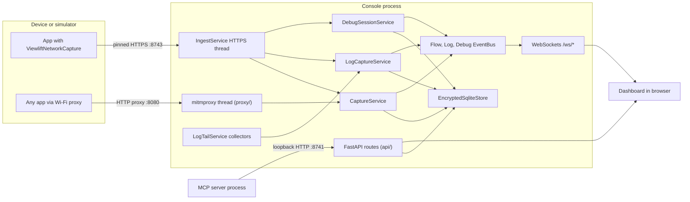

# Architecture

Viewlift AI is one Python process (FastAPI on uvicorn) plus an optional MCP process. Inside the console process, background threads run mitmproxy, the SDK ingest server and log collectors. All of them write to one encrypted SQLite store and publish live updates on event buses that feed WebSockets.

## Layers

The package is [src/viewlift_ai](../src/viewlift_ai). Dependencies point downward only.

| Layer | Path | Rule |
|---|---|---|
| Models | `models/` | Plain dataclasses and enums. No framework imports. |
| Services | `services/` | Business logic. No FastAPI imports (enforced by `tests/test_services_isolation.py`). Collaborators are injected (clocks, runners, subprocess factories). |
| Proxy | `proxy/` | Thin mitmproxy hooks that adapt mitmproxy objects to service calls. |
| API | `api/` | FastAPI routers, request parsing, loopback guards, scoping. |
| Web | `web/` | Jinja templates and static JS/CSS for the dashboard. |
| MCP | `mcp_server/` | Separate process. Talks to the console only over loopback HTTP. |

This keeps the services testable without a server and lets the MCP server stay a thin client.

## Composition root

[app.py](../src/viewlift_ai/app.py) wires everything with lazy singleton getters such as `get_config`, `get_store`, `get_event_bus`, `get_log_event_bus`, `get_debug_event_bus`, `get_rule_engine`, `get_allowlist`, `get_redaction`, `get_reveal`, `get_capture`, `get_log_capture`, `get_log_tail`, `get_ingest`, `get_setup` and `get_debug_sessions`. `_bind_app_state()` puts them on `app.state`, which is how routers reach them.

`create_app(config)` builds a fresh app for tests. `reconfigure_proxy()` restarts mitmproxy when Setup changes the bind.

### Startup

`main()`:

1. Sets `VIEWLIFT_SDK_WATCH=1`.
2. Loads config (`load_config()`): data directory, Keychain key, retention, loopback-only proxy host.
3. Opens the store and runs retention cleanup.
4. Loads `rules.json` into the `RuleEngine`. If the stored allowlist is empty, it seeds it from `VIEWLIFT_ALLOWLIST`. Allowlist changes propagate live to `HostAllowlist`.
5. Starts uvicorn on `127.0.0.1:8741`.

`lifespan()` then:

1. Ensures the mitmproxy CA exists.
2. Creates the ingest service and starts its network-follow thread (re-checks interfaces every 2 seconds).
3. Binds the uvicorn event loop to the three event buses, so worker threads can publish safely.
4. Starts `ProxyRunner` if the proxy is enabled.

### Shutdown

In order: stop log tail, stop the ingest watcher, disable ingest, wipe the reveal cache, stop the proxy, wipe the session data if retention is `session`, close the store.

## Event buses

[services/event_bus.py](../src/viewlift_ai/services/event_bus.py) defines a generic `EventBus[T]` with `FlowEventBus` and `LogEventBus` specializations, plus a debug bus.

- Each subscriber gets a bounded queue of 256 items. When full, the oldest item is dropped, so a slow browser tab never blocks capture.
- `publish_threadsafe` hands items from mitmproxy, ingest or collector threads to the uvicorn loop.
- [api/ws.py](../src/viewlift_ai/api/ws.py) pumps bus items to `/ws/flows`, `/ws/logs` and `/ws/debug`, filtered by `client_id` when the socket asks for one.

## Store

[services/encrypted_store.py](../src/viewlift_ai/services/encrypted_store.py) is `EncryptedSqliteStore`. It uses a single shared SQLite connection; every public method is serialized by an `RLock` through the `@_serialize_public_methods` decorator. Tables: `flows`, `logs`, `debug_events`, `clients`, `meta`. Schema migrations run in `_migrate_schema`. Interfaces live in [services/protocols.py](../src/viewlift_ai/services/protocols.py) (`FlowStoreProtocol`, `LogStoreProtocol`, `ClientStoreProtocol`, `StoreProtocol`).

## Module map

### Root

| Module | Responsibility |
|---|---|
| `app.py` | Entry point, singletons, lifespan, `/health` |
| `config.py` | `AppConfig`, env parsing, `KeychainSecretStore`, `load_config()` |
| `crypto.py` | `SecretBoxCipher` (PyNaCl SecretBox) for values and header maps |

### api/

| Module | Responsibility |
|---|---|
| `routes.py` | Network page, flow list/detail, reveal, HAR and cURL export |
| `ws.py` | WebSocket endpoints and pumps |
| `scope.py` | `resolve_client_ids`, `app_tag` |
| `apps_routes.py` | Device and app tree, per-app and global data clearing |
| `rules_routes.py` | Allowlist read and replace |
| `setup_routes.py` | Setup page, CA, mobileconfig, proxy bind, simulator helpers, SDK receiver |
| `logs_routes.py` | Logs page, list and detail, delete. Logs come from SDK stdout/stderr over ingest |
| `session_routes.py` | Browser tab presence and last-tab wipe |
| `debug_routes.py` | Debug Suite page, debug commands, analytics, deep link, location, replay |
| `agent_routes.py` | Agent page and MCP status |

### services/

| Module | Responsibility |
|---|---|
| `capture.py` | `CaptureService`: remember raw for reveal, redact, persist, publish |
| `encrypted_store.py` | `EncryptedSqliteStore` |
| `event_bus.py` | Bounded pub/sub with thread-safe publish |
| `ingest.py` | `IngestService`: SDK HTTPS receiver, pairing, sessions, rate limit, Bonjour |
| `debug_session.py` | `DebugSessionService`: client registry, command queues, confirmations, invoke |
| `debug_advertise.py` | `DebugAdvertiser`: `dns-sd` Bonjour advertisement of the receiver |
| `debug_toolkit.py` | Network profiles, deep links, replay, device location, module catalog |
| `analytics_inspect.py` | Classify beacon and analytics traffic |
| `ott_inspect.py` | Parse stack frames into class, file and line |
| `package_detect.py` | Find the app in DerivedData and list its Swift packages |
| `log_tail.py` | `LogTailService`: one active log source, app attribution |
| `log_capture.py` | `LogCaptureService`: persist and publish logs |
| `simulator_logs.py` | `xcrun simctl spawn <udid> log stream` collector |
| `device_logs.py` | `pymobiledevice3` syslog / OS trace collector |
| `setup.py` | `SetupService`: CA tokens, mobileconfig, proxy bind, simulator helpers |
| `bind_policy.py` | IP and port validators, interface scope |
| `reveal.py` | `RevealSession`: in-memory raw cache with unlock token |
| `rule_engine.py` | `RuleEngine`: the HTTPS decryption allowlist |
| `rule_store.py` | Atomic `rules.json` persistence |
| `browser_sessions.py` | Tracks open dashboard tabs |
| `flow_present.py`, `log_present.py` | JSON views for flows and logs |
| `flow_export.py` | HAR and cURL builders (always redacted) |
| `protocols.py` | Store protocols |
| `flow_store.py`, `log_store.py` | Re-export shims |

### proxy/

| Module | Responsibility |
|---|---|
| `addon.py` | `ViewliftCaptureAddon` mitmproxy hooks |
| `runner.py` | `ProxyRunner`: runs `DumpMaster` on its own thread and loop |
| `allowlist.py` | `HostAllowlist` (exact or glob, empty denies) |
| `redact.py` | `RedactionService` |
| `ca.py` | CA creation and public certificate export |

### models/

`flow.py`, `log.py`, `rules.py` (allowlist only). See the docstrings in each file.

### mcp_server/

`server.py` (FastMCP tool wrappers, prompts, and resources), `tools.py` (logic), `guard.py` (secret scrubbing and the call audit), `insights.py` (summaries over scrubbed rows), `client.py` (loopback HTTP client), `runtime.py` (transport and port), `catalog.py` (tool docs for the Agent page). See [MCP server and tools](mcp-server.md).

## Key files

- [src/viewlift_ai/app.py](../src/viewlift_ai/app.py)
- [src/viewlift_ai/services/encrypted_store.py](../src/viewlift_ai/services/encrypted_store.py)
- [src/viewlift_ai/services/event_bus.py](../src/viewlift_ai/services/event_bus.py)
- [tests/test_services_isolation.py](../tests/test_services_isolation.py)

Next: [Data flows](data-flows.md)
