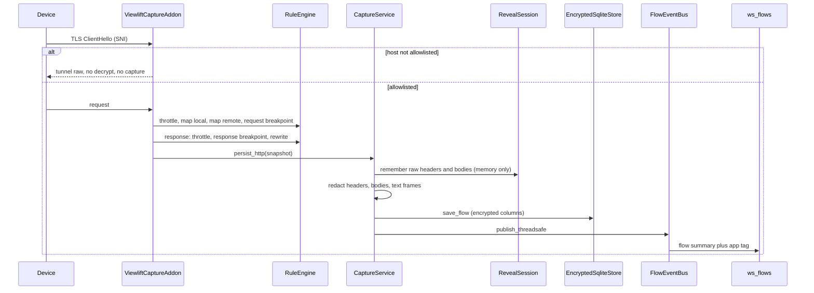
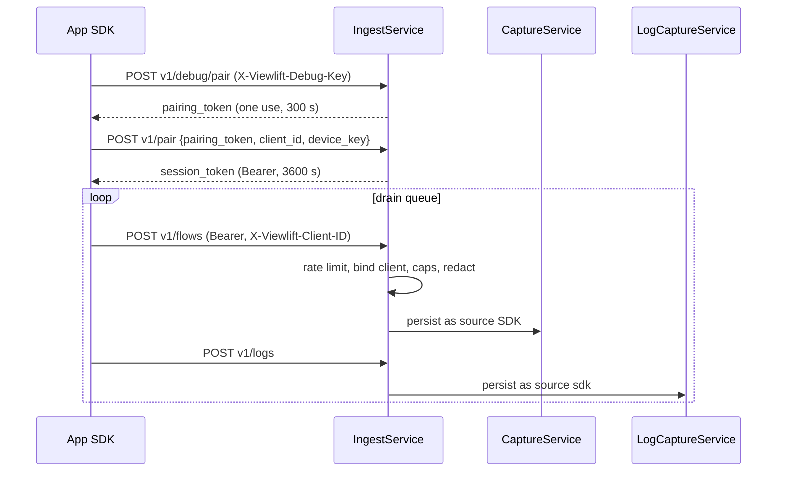
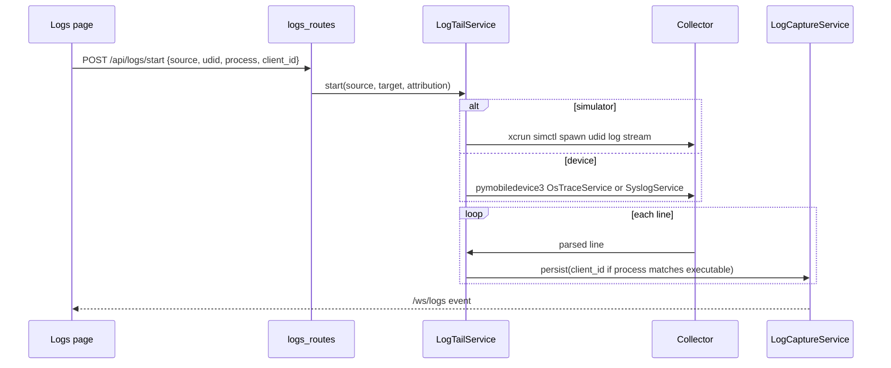
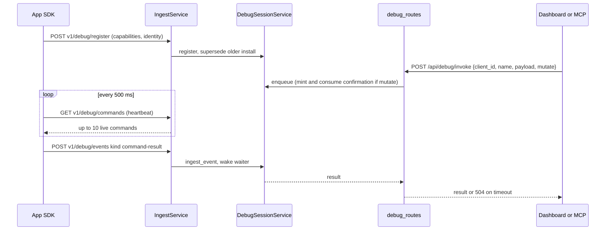

# Data flows

Four paths bring data into the console. All end in the encrypted store and an event bus.

## Proxy capture

Details:

- `tls_clienthello` checks the SNI (or server IP) with `HostAllowlist.allows`. On a miss it sets `ignore_connection`, so traffic is passed through encrypted.
- Plain HTTP to a non-allowlisted host is not captured, but request rules still run on it because the request hook runs before the allowlist check.
- TLS handshake failures become a `CONNECT` row marked `TLS failed (likely certificate pinning)`, de-duplicated per host.
- Each WebSocket message re-saves the whole flow (same id), so the frames list grows in place.
- `request_id` is taken from `x-request-id`, `request-id` or `x-correlation-id`.
- Proxy flows have `client_id=None`. They are never attributed to an app.

## SDK ingest

Enabling the receiver (`POST /api/setup/sdk/enable`):

1. Validates the bind address (loopback, or an active LAN or VPN address; never `0.0.0.0`).
2. Creates a self-signed certificate at `ingest/ingest-cert.pem` on first use and computes its SHA-256 DER fingerprint. That fingerprint is the pin the SDK checks.
3. Starts a `ThreadingHTTPServer` with TLS 1.2 or later.
4. Advertises `_viewliftdebug._tcp` over Bonjour with TXT keys `ip`, `port`, `fp` and `key`.

Pairing tokens can also come from the dashboard (`POST /api/setup/sdk/pairing-token`). The debug key is stored in `ingest/debug.key` and stays the same across runs.

Session rules:

- 600 requests per minute per session, otherwise `429`.
- The first `client_id` a session presents binds it. A different id later gets `403`.
- Request JSON is capped at 1 MiB; each body at 262,144 bytes. Bodies are base64.
- Redaction runs in ingest (with the SDK's `extra_redaction_keys`) and again in `CaptureService`.

Payload shapes are in [API reference, ingest server](api-reference.md#sdk-ingest-server).

## Logs

- Only one source streams at a time. Starting the same source and target again only updates the filter, so a USB session is not reopened.
- When `client_id` is given, the route fills in the rest: a simulator app uses its `device_key` as UDID, and `process` becomes the app's executable.
- Process and subsystem filters must match `[A-Za-z0-9 ._-]{1,64}` because they go into the `simctl` predicate.
- A line is attributed to an app only if its process equals the attributed executable. Otherwise it is stored with `udid` and no `client_id`.
- `request_id` is extracted from the text (`requestId`, `request_id`, `x-request-id`), and log detail links to the matching flow.
- SDK logs come only through ingest `/v1/logs`.
- While a device stream holds the USB connection, the device list is cached and location simulation returns `409`.

## Debug bridge

- An app is online if it was seen in the last 45 seconds.
- Commands expire after 30 seconds. Each client queue holds at most 100.
- Command payloads are capped at 64 KB, events at 512 KB.
- Mutating commands from the dashboard use two calls: `POST /api/debug/confirm` returns a one-use, 30-second token bound to that client and command; `POST /api/debug/command` then sends it with `confirmation`.
- `POST /api/debug/invoke` (used by MCP) needs an online `client_id`. With `mutate: true` the server mints and consumes the confirmation itself. It waits 12 seconds by default, 25 seconds at most.
- For `module == "keychain"` events, keys `value`, `data`, `secret`, `password` and `token` are removed recursively before storage.
- `/ws/debug` streams `debug-client`, `debug-command`, `debug-event` and `apps-changed` events.

## Key files

- [src/viewlift_ai/proxy/addon.py](../src/viewlift_ai/proxy/addon.py)
- [src/viewlift_ai/services/capture.py](../src/viewlift_ai/services/capture.py)
- [src/viewlift_ai/services/ingest.py](../src/viewlift_ai/services/ingest.py)
- [src/viewlift_ai/services/log_tail.py](../src/viewlift_ai/services/log_tail.py)
- [src/viewlift_ai/services/debug_session.py](../src/viewlift_ai/services/debug_session.py)

Next: [Configuration](configuration.md)
