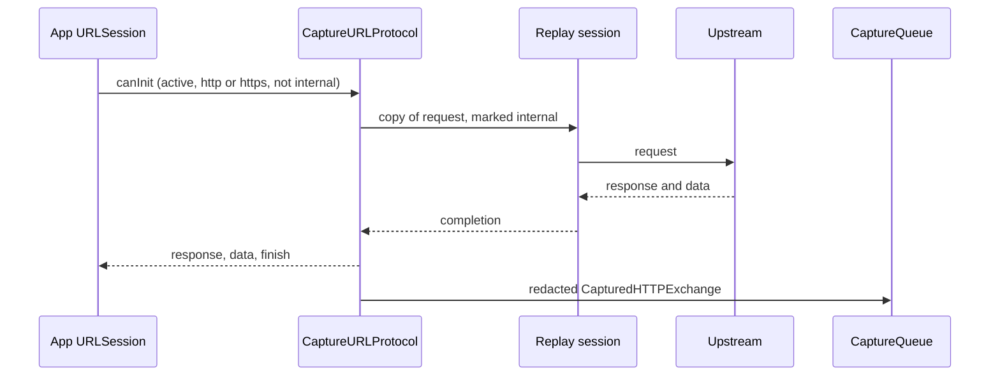

# iOS SDK internals

This page is for people changing `ViewliftNetworkCapture`. Sources are in [ios/ViewliftNetworkCapture/Sources/ViewliftNetworkCapture](../ios/ViewliftNetworkCapture/Sources/ViewliftNetworkCapture).

## Design

The package follows a service-oriented design with protocol seams for testing:

- `CaptureService` orchestrates; it depends on `CaptureTransporting`, not a concrete transport.
- `Protocols.swift` defines `Redacting`, `CaptureQueuing`, `CaptureTransporting`, `DebugTransporting`, `CaptureServing` and `LogServing`.
- Debug features are separate services (`StateDebugService`, `UIInspectionService`, `MemoryDebugService` and so on) dispatched by `DebugCommandExecutor`.
- Shared state lives in `CaptureRuntime`, guarded by locks.

The package has no external dependencies. It uses Foundation, ObjectiveC runtime, CommonCrypto, Security, OSLog, Network, SQLite3, AVFoundation, and UIKit, SwiftUI and UserNotifications where available.

## Files

| File | Responsibility |
|---|---|
| `CaptureConfiguration.swift` | Configuration value type; normalizes the fingerprint and clamps limits |
| `CaptureService.swift` | Start and stop: runtime, log binding, interceptor, debug bridge, transport |
| `CaptureRuntime.swift` | Shared active flag, config, redactor and queue; internal header marker |
| `CaptureURLProtocol.swift` | Intercepts requests, replays them on a clean session, records the exchange |
| `ConfigurationInterceptor.swift` | Registers the protocol and swizzles `URLSessionConfiguration.default` and `.ephemeral` |
| `CaptureQueue.swift` | Bounded FIFO that drops the oldest item |
| `BodyCap.swift` | Truncation and base64 |
| `RedactionService.swift` | `HeaderJSONRedactor` |
| `Models.swift` | `CapturedHTTPExchange`, `CapturedLogEvent`, `CaptureLogLevel` |
| `Protocols.swift` | Dependency-inversion protocols |
| `LogService.swift` | Direct log upload |
| `PinnedTransport.swift` | `PinnedHTTPSTransport`: pairing, drain loop, debug endpoints, discovery adoption |
| `PinnedTransport+Pinning.swift` | SHA-256 leaf certificate pin |
| `PinnedTransport+Recovery.swift` | `ConnectionRecovering`: reconnect, wake, address fallback, remembered receiver |
| `ReceiverRoute.swift` | Candidate addresses, failure tracking, `RememberedReceiver` store |
| `ConnectionLifecycleMonitor.swift` | Foreground, background and network-path events; background task grace |
| `TransportModels.swift` | `PairResponse`, `DebugPairResponse`, `TransportError` |
| `ReceiverDiscovery.swift` | Bonjour browse (`NWBrowser`), TXT parsing, adoption rules |
| `ClientIdentity.swift` | `client_id` and `DeviceIdentity` |
| `AppIdentity.swift` | Bundle, version, executable, URL schemes, frameworks |
| `DebugModels.swift` | `DebugModule`, `JSONValue`, registration, command and event models |
| `DebugBridgeService.swift` | Register, sample, poll, execute, report loop |
| `DebugCommandExecutor.swift` | Command routing and module gating |
| `PerformanceCollector.swift` | CPU, memory, thermal state, FPS, hang watchdog |
| `MemoryDebugService.swift` | Weak tracking from `viewDidLoad`, leak detection after dismissal, live feed and leak events |
| `LeakReport.swift` | Leak report: creation stack, retention, actions, console, replay; physical footprint |
| `LeakReplayRecorder.swift` | Rolling 2 fps low-resolution screen recording with normalized touches |
| `RetentionInspector.swift` | Reflection and ivar walk for retainers, cycle candidates, and cause hints |
| `MemoryGraphBuilder.swift` | Object graph two hops from tracked objects; heap census formatting |
| `HeapCensus.swift` | Malloc zone walk that counts live instances per class without allocating while zones are locked |
| `StateDebugService.swift` | UserDefaults, keychain metadata, sandbox files, read-only SQLite, snapshots |
| `UIInspectionService.swift` | Hierarchy, highlight, edit, screenshot, asset and accessibility audits |
| `QADebugService.swift` | `MacroRecorder` and `PushDebugService` |
| `CrashHangRecorder.swift` | Hang events and frame parsing. Installs the crash coordinator and the `NSException` handler |
| `ViewliftCrashSignals.c` | Async-signal-safe handler for fatal signals. Writes a text record to a pre-opened file |
| `FatalCrashCoordinator.swift` | Recovers last-run crashes, stages events on disk, sends an `NSException` crash before the app dies |
| `CrashRecordParser.swift` | Parses the signal record and builds the `crash` / `fatal` event with frames and images |
| `CrashStore.swift` | `Caches/ViewliftCrash`: the pending record and up to 10 unsent events |
| `ExceptionCrashRecord.swift` | Builds a record from `NSException.callStackReturnAddresses` |
| `CrashContextWriter.swift` | Writes `context.json` (screens, taps, presses, requests, console, performance, environment) once a second |
| `CrashReplayRing.swift`, `CrashReplayRecorder.swift` | 40-slot JPEG ring on disk, four frames a second, with touches per frame |
| `CrashReplayEncoder.swift` | `AVAssetWriter` H.264 MP4 from a frozen ring, taps and a countdown caption drawn |
| `CrashReplayUploader.swift` | Encodes on the next launch and sends `crash/replay-chunk` events, resuming after an interrupted upload |
| `SwiftUIRenderTracker.swift` | `viewliftRenderProbe` counts |
| `RuntimeBrowser.swift` | ObjC class search and describe |
| `OTTDebugProvider.swift` | Host OTT snapshot hook |
| `ActivityDebugService.swift` | Live screen and playback sample, host activity hook, one-second feed |
| `PlaybackDebugService.swift` | Playback timeline, DRM notes, and the visible-player follower |
| `PlaybackPlayerBinding.swift` | AVPlayer status, stalls, bitrate, live edge, route. No asset URL |
| `PlaybackWaterfall.swift` | HLS/DASH metadata recorder. No query string or body |
| `FocusDebugMonitor.swift` | Focused view, focus rejection, Menu / Play/Pause / Select |
| `NavigationDebug.swift` | `nav.open_url` on the device. Query is not echoed |
| `AutomationModels.swift` | Payload reads, `ElementQuery`, role names, scroll math, focus direction picking. Foundation only |
| `AccessibilityTreeService.swift` | Accessibility tree walk, element lookup, `ui.wait_for`, screen name |
| `UIKitSemantics.swift` | Labels, values, and traits for stock UIKit views when the accessibility runtime is not loaded |
| `UIAutomationService.swift` | Tap, custom actions, scroll, typing, and keys |
| `TVRemoteService.swift` | tvOS focus moves, select, menu, and play/pause |
| `PreviewRegistry.swift` | `ViewliftPreviews.register` and the thread-safe preview store |
| `PreviewRenderService.swift` | Off-screen preview rendering to PNG |
| `DebugCommandExecutor+Automation.swift` | Routes `ui.*` automation and `preview.*` commands |
| `IntegrationGuidance.swift` | Integration notes and the local network usage string |

## Interception

1. `ConfigurationInterceptor.install()` calls `URLProtocol.registerClass` (covers `URLSession.shared`) and swizzles the `default` and `ephemeral` getters once, inserting `CaptureURLProtocol` first in `protocolClasses`.
2. `canInit` accepts only when the runtime is active, the scheme is http or https, and the request is not already marked internal (header `X-Viewlift-Capture-Internal` or a `URLProtocol` property).
3. `startLoading` marks the request and runs it on a replay session built from `URLSessionConfiguration.default` with `CaptureURLProtocol` removed, so cookies, cache and credentials still apply.
4. `recordExchange` caps bodies, redacts, base64-encodes, reads `X-Request-Id` / `Request-Id`, and publishes to the queue.
5. `stop()` unregisters the class and deactivates the runtime. Swizzles stay installed but become no-ops.

## Transport

`PinnedHTTPSTransport` sends everything:

- Its own ephemeral session with empty `protocolClasses` (never intercepted), `connectionProxyDictionary = [:]` (bypasses the system proxy) and a 15-second timeout.
- **Pairing** (`resolvePairingToken`): use `pairingToken` if set, else call `POST v1/debug/pair` with the debug key, then `POST v1/pair` with `client_id` and `device_key`. The session token is kept in memory.
- **Drain loop**: if not paired, pair with exponential backoff (1 to 30 seconds). Otherwise dequeue and upload; sleep 200 ms when idle. `401` clears the token and re-queues the item. Other errors drop the item.
- **Pinning**: `urlSession(_:didReceive:completionHandler:)` hashes the leaf certificate DER with SHA-256 and compares it to the pin. System trust and hostname checks are intentionally skipped because the receiver certificate is self-signed.

## Discovery

`ReceiverDiscovery` browses `_viewliftdebug._tcp` with `NWBrowser` (peer-to-peer allowed) and reads TXT keys `ip`, `port`, `fp`, `key`, falling back to a `NetService` TXT resolve. `ReceiverAddress.shouldAdopt` rejects empty, `0.0.0.0`, link-local and (on hardware) `127.0.0.1` hosts. When the advertised receiver differs, the transport swaps URL, pin and debug key and clears the session so it re-pairs.

## Identity

- `UserDefaultsClientIdentity` stores a UUID under `com.viewlift.networkcapture.client-id`.
- `DeviceIdentity` uses `SIMULATOR_UDID` on simulators, `vendor:<identifierForVendor>` on hardware, or `hint:<model>|<name>`. `device_hint` is a SHA-256 prefix of model, OS version, and boot time, empty on simulators. `sdkVersion` is reported in registration.
- `AppIdentity.current` collects display name, bundle id, version, build, executable, URL schemes and up to 400 non-system frameworks.

## Debug bridge loop

`DebugBridgeService.start` does nothing when `debugModules` is empty. Otherwise it starts the performance collector and installs memory tracking, the macro recorder and the crash handler, then runs two loops.

Telemetry loop:

1. Register once (platform, OS, capabilities, app and device identity, and the current capture session when the host has called `reportCaptureSession`). This fails until the transport has paired, then retries. A later session change is sent as a `session` / `update` event and is not stored as a debug event.
2. Send the optional telemetry (performance samples, activity, crashes, replays). A payload the receiver refuses with 400, 413, 422 or 429 is logged and dropped. It never tears down the registration.
3. Sleep 500 ms (250 ms while a screen preview runs). On a connection error, reset registration and sleep 2 seconds. While the transport is still starting or re-pairing (`notStarted`, `notPaired`) it retries after 250 ms instead.

Command loop, independent of the telemetry loop so a slow upload never delays a command:

1. Wait until registration is ready.
2. Poll `v1/debug/commands` and drop expired commands.
3. Run each batch in its own task, in order, and post `command-result` events `{command_id, name, ok, result | error}`.
4. On a connection error, ask the telemetry loop to register again.

If the app registers again while a read command is in flight, the console sends that read once more. A mutating command is not repeated; the dashboard reports it as interrupted.

### Foreground, background and network changes

iOS suspends the app, and its sockets, soon after it leaves the foreground. `ConnectionLifecycleMonitor` reports three events to the bridge:

- `background` (`didEnterBackground`): the bridge sends a `lifecycle` / `background` event inside a short background task, so the dashboard shows "background" instead of "offline".
- `foreground` (`didBecomeActive`, only after a background): the bridge calls `reconnect(reason:)` on the transport, which drops the session token, cancels in-flight tasks, restarts Bonjour browsing and wakes the pair loop with its backoff reset. The bridge then registers again and sends a `lifecycle` / `foreground` event that carries `recent_failures`, the last connection errors (time, path, error code).
- `networkChanged` (`NWPathMonitor` signature of status plus interfaces changes while satisfied and in the foreground): same reconnect. This covers a Wi-Fi switch and Tailscale coming up.

A `401` on any request clears the token so the pair loop runs again. Two consecutive connectivity failures (`timedOut`, `cannotConnectToHost`, `networkConnectionLost` and similar) move the transport to the next known address.

### Addresses and Tailscale

The Bonjour TXT record can carry `alt=<ip>,<ip>` next to `ip`. `ReceiverCandidates` keeps the primary address first and the alternates after it. The last accepted dashboard (hosts, port, fingerprint, debug key) is stored in `UserDefaults` under `com.viewlift.networkcapture.receiver`. On launch, when no key was configured, the transport reuses it before Bonjour answers, so a phone away from the Mac's Wi-Fi can reach the Tailscale address. Bonjour results still take precedence when they arrive. The stored debug key is a local debug credential, protected by the certificate pin like the rest of the exchange.

A Tailscale address (100.64.0.0/10) stays the same for a Mac, so both sides keep it:

- **Mac.** The console saves the VPN addresses it has bound in `receiver.json` (`vpn_hosts`, at most 4) and keeps advertising them in `alt=` while Tailscale is down. The Setup page shows the state under "Off the Wi-Fi (VPN)". `follow_network` rebinds the receiver within seconds when Tailscale comes up.
- **Phone.** `ReceiverAddress.mergingVPN` adds the VPN addresses already remembered to each new record, so an advertisement without `alt=` never erases them. After two connection failures on the Wi-Fi address the route rotates to the Tailscale address.
- **First run.** The phone must see this Mac's advertisement once, on any network where Bonjour works, while the console has Tailscale up. After that it reaches the Mac from any network. Without that, set `VIEWLIFT_CAPTURE_HOST`, `VIEWLIFT_CAPTURE_PORT`, `VIEWLIFT_CAPTURE_FINGERPRINT` and `VIEWLIFT_CAPTURE_DEBUG_KEY` in the Xcode scheme.
- **Stale advertisements.** A killed console can leave its `dns-sd` process running with an old address. The console and `scripts/viewlift-ai.sh stop` stop those processes. `ensure_ca` no longer aborts startup when it cannot chmod an existing CA key that is already private.

Capabilities: enabled modules report `available`; `memory`, `swiftui` and `macro` report `partial`; disabled ones `unsupported`; `push` is `partial` on tvOS (badge only). `network_shaping` is `available` when network capture is on. An extra `ui_automation` key reports `partial` when the `ui` module is on, because long presses and raw touches need the UI runner or the simulator path. `BackgroundGrace` covers iOS and tvOS.

## Commands

The prefix before the first dot selects the module. A disabled module returns `moduleDisabled`.

| Module | Commands and payload |
|---|---|
| performance | `performance.snapshot` |
| memory | `memory.snapshot`, `memory.graph`, `memory.leaks`, `memory.heap`, `memory.object {id}`, `memory.live_start`, `memory.live_stop`; pushed events `memory/live` (not stored) and `memory/leak` |
| ui | `ui.hierarchy`, `ui.layers {offset?, ids?, scale?}`, `ui.describe {id}`, `ui.highlight {id}`, `ui.edit {id, alpha?, hidden?}`, `ui.visual {slow?, guidelines?, baselines?, oversized?, repaint?}`, `ui.screenshot`, `ui.focus`. Pushed events `ui/focus` and `ui/remote` (not stored). Remote events are Menu, Play/Pause, and Select. Automation: `ui.accessibility_tree {limit?}`, `ui.find {label?, identifier?, text?, role?, view_id?, index?}`, `ui.wait_for {query keys, gone?, timeout?}`, `ui.tap {query keys or x, y}`, `ui.long_press {query keys, action?}`, `ui.swipe {direction, query keys?, fraction?}`, `ui.scroll {direction, query keys?, fraction?}`, `ui.type_text {text, query keys?, replace?, submit?}`, `ui.key {key, count?}`, `ui.remote {press, repeat?}` (tvOS). |
| preview | `preview.list`, `preview.render {name, state?, color_scheme?, width?, height?, scale?}` |
| bug | `bug.capture` (screenshot, performance, memory) |
| swiftui | `swiftui.renders` |
| assets | `assets.audit` |
| accessibility | `accessibility.audit` |
| storage | `storage.defaults`, `storage.defaults_set {key, value}`, `storage.defaults_delete {key}`, `storage.keychain_metadata`, `storage.files {path}`, `storage.file_read {path}`, `storage.file_write {path, content, base64?}`, `storage.file_rename {path, name}`, `storage.file_delete {path}`, `storage.sqlite_schema {path}`, `storage.sqlite_query {path, query}`, `storage.snapshot_create {paths}`, `storage.snapshot_restore {snapshot}`, `storage.cookies`, `storage.cookie_delete {name, domain, path}` |
| runtime | `runtime.search {query}`, `runtime.describe {class}`, `runtime.libraries`, `runtime.image_classes {image}` |
| explorer | `explorer.roots`, `explorer.object {handle?, view_id?, memory_id?}`, `explorer.instances {class, limit?}`, `explorer.set {handle, key, value}`, `explorer.call {handle, selector}`. Handles are weak. `explorer.call` refuses `init`, `set`, `copy`, `dealloc`, and teardown selectors |
| settings | `settings.get`, `settings.set {modules?, capture_network?, max_request_body_bytes?, max_response_body_bytes?, body_content_types?, reset?}`. Overrides can disable modules the app enabled. They cannot add modules |
| macro | `macro.record_start`, `macro.record_stop`, `macro.list`, `macro.replay {actions}` |
| push | `push.local {title, body, sound?, badge?, user_info?, delay?}` |
| ott | `ott.snapshot` |
| crash, hang | `crash.list` (fatal signals and uncaught exceptions with frames and images), `hang.list` (screen class, screenshot, taps and scrolls, console, stack) |
| activity | `activity.snapshot`, `activity.live_start {preview?}`, `activity.live_stop`; pushed events `activity/live` and `activity/frame` (not stored). Screen class and title, foreground or background, and playback (`playing`, `paused`, `buffering`, or `none`; live when duration is indefinite). No asset URL. Host keys `title`, `content_id`, `state`, `is_live`, `position_seconds`, `rate` override the probe. `preview: true` pushes a small JPEG about three times a second. |
| playback | `playback.snapshot`, `playback.drm`, `playback.waterfall`. Pushed event `playback/event` (not stored). Stalls, bitrate, live-edge lag, variant size, dropped frames, route, external playback, ad breaks, and DRM step timing. No stream URL, query string, SPC, or CKC. The waterfall keeps 120 playlist, manifest, init, and segment rows. |
| nav | `nav.open_url {url}`. Opens the URL in the debug build. `javascript`, `data`, and `file` are rejected. The reply omits query and userinfo. |

Notable limits:

- Storage paths are relative to `NSHomeDirectory()`; absolute paths and NUL bytes are rejected. Files up to 512 KB. SQLite opens read-only and accepts a single `SELECT`, `PRAGMA`, `WITH` or `EXPLAIN`, up to 1,000 rows. Keychain returns attributes only.
- Screenshots up to 480 KB (400 KB in `bug.capture`).
- Hierarchy depth 100, 2,500 nodes per capture. View controllers appear as parents of their root views.
- SwiftUI hosts expand into the SwiftUI view tree from `_UIHostingView.makeViewDebugData()`, the private method Xcode's view debugger uses. UIKit views hosted by SwiftUI are placed under the SwiftUI node whose frame contains them. SwiftUI records this tree only when `SWIFTUI_VIEW_DEBUG` is set before the first hosting view exists. The debug bridge sets it to `29` (type, transform, position, size) when the `ui` module starts, unless the scheme already sets it. Hosts created earlier fall back to accessibility nodes.
- `ui.layers` pages per-view images from the last `ui.hierarchy`: each view's own pixels with its direct subviews hidden, about 420 KB per page, longest side 1,024 px. Video, Metal, and blur views come back in `crop` so the dashboard uses the window screenshot. Views with no pixels come back in `empty`.
- Macros record `UIControl` target-action only, up to 1,000 actions.
- The accessibility tree lists at most 1,000 elements, 80 levels deep, and only elements whose frame is inside a visible window. `ui.wait_for` polls every 250 ms for at most 10 seconds; the MCP tool repeats it to reach 20. Typed text is capped at 2,000 characters and is not echoed. Secure field values are never listed.
- `ui.remote` and focus moves need a focused item. Directions pick the nearest focusable item whose center lies that way, weighting sideways drift double.
- Preview renders are at most 2,400 points per side and scale 1 to 3, and must fit in 480 KB; the scale is halved until they do.
- Crash capture covers fatal signals (`SIGABRT`, `SIGSEGV`, `SIGBUS`, `SIGILL`, `SIGTRAP`, `SIGFPE`, `SIGSYS`) and uncaught `NSException`. Swift runtime traps (arithmetic overflow, force unwrap of `nil`, failed preconditions) raise `SIGTRAP` or `SIGILL`, which the exception handler never sees.
- A signal crash cannot use the network. The handler walks frame pointers, writes the record, restores the previous handlers, and returns so the system still files its own `.ips`. The SDK sends the event on the next launch (`previous_session: true`). An uncaught exception is saved, then sent synchronously for up to one second before the app dies.
- The SDK records raw addresses and image UUIDs. The console adds symbols, files, and lines (see [Crash reports](mcp-server.md#crash-reports)). `tvOS` has no `sigaltstack`, so a stack overflow there is left to the `.ips`.
- With a debugger attached no handler runs and no report is filed. The registration carries `debugger_attached` so the console can say so.
- Crash events use module `crash`, kind `fatal`. Payload `kind` is `fatal` or `exception`. `source` is `sdk-signal` or `sdk-exception`.
- Replay layout under `Caches/ViewliftCrash`: `replay/` is the live ring (`frame-00.jpg` to `frame-39.jpg`, `index.json`, `context.json`). On a crash the folder moves to `replays/<crash id>/` (at once for an exception, at the next launch for a signal) and gets `crash.json` (pid and time). A launch without a crash deletes `replay/`. At most 3 frozen replays are kept.
- The crash event carries `context` and `replay: {status: "pending", frames, duration_ms}`. The video (about 600 kbit/s, typically under 1 MB) is sent after its crash event, in chunks of 225 000 bytes (300 000 base64 characters), with `index`, `total`, `pid`, and on chunk 0 the frame `timeline` and a `poster` JPEG. Progress is kept in `progress.json`, and the folder is deleted after the last chunk. An encoding error sends `crash/replay-failed`.
- Replay frames are taken with `drawHierarchy(afterScreenUpdates: false)`, so video, Metal, and secure fields may show black, as in other snapshots. Frames stop while the app is not active.
- Hang capture keeps 12 stalls. A stall is a main-thread delay past 400 ms. Each JPEG screenshot is at most 32 KB. `hang.list` drops older screenshots after 220 KB so the reply stays under the debug event cap. The stack is sampled by suspending the main thread on arm64 iOS and tvOS. The screenshot is taken when that thread resumes, because UIKit cannot draw during the stall. Each new stall is also pushed as module `hang`, kind `detected`, so the dashboard can toast it without waiting for `hang.list`.
- Runtime browser and memory graph see Objective-C metadata only.

Which of these an agent may call, and how the results are masked, is in [MCP server and tools](mcp-server.md). To add a command, see [Contributing](contributing.md#add-a-debug-command).

## Compile guards

Debug-only files are wrapped in `#if DEBUG || VIEWLIFT_CAPTURE_ENABLED`. Core types (`CaptureService`, `CaptureURLProtocol`, `PinnedHTTPSTransport`, the redactor and the queue) always compile, but `start` is a no-op outside those conditions. Host code that references debug-only types must use the same guard.

## Lint

[.swiftlint.yml](../ios/ViewliftNetworkCapture/.swiftlint.yml) covers `Sources` and `Tests`:

- opt-in rules: `empty_count`, `explicit_init`, `first_where`, `sorted_imports`;
- `function_body_length` warning 60, error 100;
- `line_length` warning 120, error 160;
- `identifier_name` minimum 2 (with `id` and `ok` excluded), `type_name` minimum 3.

Do not disable rules unless there is no alternative; if you must, scope the disable to the smallest block and note why in the pull request.

## Tests

[Tests/ViewliftNetworkCaptureTests](../ios/ViewliftNetworkCapture/Tests/ViewliftNetworkCaptureTests) has XCTest coverage for redaction, body caps, the queue, recursion guard, start and stop, configuration injection, interception (with a stub upstream protocol), `JSONValue`, storage path safety, keychain metadata, the runtime browser, identity and discovery address replacement, element queries, scroll and focus math, and the preview registry. `AccessibilityTreeTests` (tree walk, UIKit fallback, activation, text inputs) and the preview render guards need UIKit, so run them with `xcodebuild test` on an iOS or tvOS simulator. Pinning and the drain loop are not covered.

## Known issues

- Bodies are truncated before redaction, so truncated JSON cannot be parsed and is sent unredacted.
- `Authorization` and `token` are not redacted by default.
- Discovery adopts the first Bonjour result even if a receiver was configured explicitly, and the debug key travels in the TXT record. On an untrusted network another host could receive the traffic.
- The internal marker header reaches upstream servers.
- `VIEWLIFT_CAPTURE_ENABLED` on the app target does not reach the package.
- `CaptureService.dropCount` reads the queue without the lock.

## Key files

- [ios/ViewliftNetworkCapture/Package.swift](../ios/ViewliftNetworkCapture/Package.swift)
- [Package.swift](../Package.swift)

Next: [AppCMS integration](appcms-integration.md)
