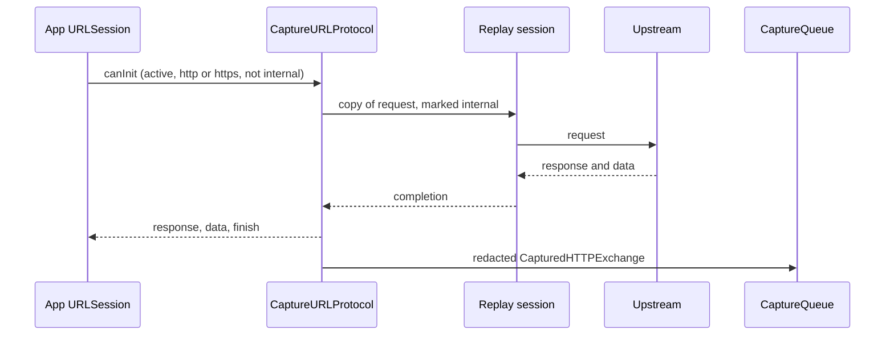

# iOS SDK internals

This page is for people changing `ViewliftNetworkCapture`. Sources are in [ios/ViewliftNetworkCapture/Sources/ViewliftNetworkCapture](../ios/ViewliftNetworkCapture/Sources/ViewliftNetworkCapture).

## Design

The package follows a service-oriented design with protocol seams for testing:

- `CaptureService` orchestrates; it depends on `CaptureTransporting`, not a concrete transport.
- `Protocols.swift` defines `Redacting`, `CaptureQueuing`, `CaptureTransporting`, `DebugTransporting`, `CaptureServing` and `LogServing`.
- Debug features are separate services (`StateDebugService`, `UIInspectionService`, `MemoryDebugService` and so on) dispatched by `DebugCommandExecutor`.
- Shared state lives in `CaptureRuntime`, guarded by locks.

The package has no external dependencies. It uses Foundation, ObjectiveC runtime, CommonCrypto, Security, OSLog, Network, SQLite3, and UIKit, SwiftUI and UserNotifications where available.

## Files

| File | Responsibility |
|---|---|
| `CaptureConfiguration.swift` | Configuration value type; normalizes the fingerprint and clamps limits |
| `CaptureService.swift` | Start and stop: runtime, log binding, interceptor, debug bridge, transport |
| `CaptureRuntime.swift` | Shared active flag, config, redactor and queue; internal header marker |
| `CaptureURLProtocol.swift` | Intercepts requests, replays them on a clean session, records the exchange |
| `ConfigurationInterceptor.swift` | Registers the protocol and swizzles `URLSessionConfiguration.default` and `.ephemeral` |
| `CaptureQueue.swift` | Bounded FIFO that drops the oldest item |
| `BodyCap.swift` | Truncation and base64 |
| `RedactionService.swift` | `HeaderJSONRedactor` |
| `Models.swift` | `CapturedHTTPExchange`, `CapturedLogEvent`, `CaptureLogLevel` |
| `Protocols.swift` | Dependency-inversion protocols |
| `LogService.swift` | Direct log upload |
| `PinnedTransport.swift` | `PinnedHTTPSTransport`: pairing, drain loop, debug endpoints, discovery adoption |
| `PinnedTransport+Pinning.swift` | SHA-256 leaf certificate pin |
| `PinnedTransport+Recovery.swift` | `ConnectionRecovering`: reconnect, wake, address fallback, remembered receiver |
| `ReceiverRoute.swift` | Candidate addresses, failure tracking, `RememberedReceiver` store |
| `ConnectionLifecycleMonitor.swift` | Foreground, background and network-path events; background task grace |
| `TransportModels.swift` | `PairResponse`, `DebugPairResponse`, `TransportError` |
| `ReceiverDiscovery.swift` | Bonjour browse (`NWBrowser`), TXT parsing, adoption rules |
| `ClientIdentity.swift` | `client_id` and `DeviceIdentity` |
| `AppIdentity.swift` | Bundle, version, executable, URL schemes, frameworks |
| `DebugModels.swift` | `DebugModule`, `JSONValue`, registration, command and event models |
| `DebugBridgeService.swift` | Register, sample, poll, execute, report loop |
| `DebugCommandExecutor.swift` | Command routing and module gating |
| `PerformanceCollector.swift` | CPU, memory, thermal state, FPS, hang watchdog |
| `MemoryDebugService.swift` | Weak tracking, leak suspects, ivar graph |
| `StateDebugService.swift` | UserDefaults, keychain metadata, sandbox files, read-only SQLite, snapshots |
| `UIInspectionService.swift` | Hierarchy, highlight, edit, screenshot, asset and accessibility audits |
| `QADebugService.swift` | `MacroRecorder` and `PushDebugService` |
| `CrashHangRecorder.swift` | `NSException` handler, hang events, frame parsing |
| `SwiftUIRenderTracker.swift` | `viewliftRenderProbe` counts |
| `RuntimeBrowser.swift` | ObjC class search and describe |
| `OTTDebugProvider.swift` | Host OTT snapshot hook |
| `DebugFeatureFlags.swift` | Host-registered flags with in-memory overrides |
| `IntegrationGuidance.swift` | Integration notes and the local network usage string |

## Interception

1. `ConfigurationInterceptor.install()` calls `URLProtocol.registerClass` (covers `URLSession.shared`) and swizzles the `default` and `ephemeral` getters once, inserting `CaptureURLProtocol` first in `protocolClasses`.
2. `canInit` accepts only when the runtime is active, the scheme is http or https, and the request is not already marked internal (header `X-Viewlift-Capture-Internal` or a `URLProtocol` property).
3. `startLoading` marks the request and runs it on a replay session built from `URLSessionConfiguration.default` with `CaptureURLProtocol` removed, so cookies, cache and credentials still apply.
4. `recordExchange` caps bodies, redacts, base64-encodes, reads `X-Request-Id` / `Request-Id`, and publishes to the queue.
5. `stop()` unregisters the class and deactivates the runtime. Swizzles stay installed but become no-ops.

## Transport

`PinnedHTTPSTransport` sends everything:

- Its own ephemeral session with empty `protocolClasses` (never intercepted), `connectionProxyDictionary = [:]` (bypasses the system proxy) and a 15-second timeout.
- **Pairing** (`resolvePairingToken`): use `pairingToken` if set, else call `POST v1/debug/pair` with the debug key, then `POST v1/pair` with `client_id` and `device_key`. The session token is kept in memory.
- **Drain loop**: if not paired, pair with exponential backoff (1 to 30 seconds). Otherwise dequeue and upload; sleep 200 ms when idle. `401` clears the token and re-queues the item. Other errors drop the item.
- **Pinning**: `urlSession(_:didReceive:completionHandler:)` hashes the leaf certificate DER with SHA-256 and compares it to the pin. System trust and hostname checks are intentionally skipped because the receiver certificate is self-signed.

## Discovery

`ReceiverDiscovery` browses `_viewliftdebug._tcp` with `NWBrowser` (peer-to-peer allowed) and reads TXT keys `ip`, `port`, `fp`, `key`, falling back to a `NetService` TXT resolve. `ReceiverAddress.shouldAdopt` rejects empty, `0.0.0.0`, link-local and (on hardware) `127.0.0.1` hosts. When the advertised receiver differs, the transport swaps URL, pin and debug key and clears the session so it re-pairs.

## Identity

- `UserDefaultsClientIdentity` stores a UUID under `com.viewlift.networkcapture.client-id`.
- `DeviceIdentity` uses `SIMULATOR_UDID` on simulators, `vendor:<identifierForVendor>` on hardware, or `hint:<model>|<name>`. `sdkVersion` is reported in registration.
- `AppIdentity.current` collects display name, bundle id, version, build, executable, URL schemes and up to 400 non-system frameworks.

## Debug bridge loop

`DebugBridgeService.start` does nothing when `debugModules` is empty. Otherwise it starts the performance collector and installs memory tracking, the macro recorder and the crash handler, then loops:

1. Register once (platform, OS, capabilities, app and device identity). This fails until the transport has paired, then retries.
2. Send a `performance/sample` event if due.
3. Poll `v1/debug/commands` and run each unexpired command.
4. Post `command-result` events `{command_id, name, ok, result | error}`.
5. Sleep 500 ms. On error, reset registration and sleep 2 seconds. While the transport is still starting or re-pairing (`notStarted`, `notPaired`) it retries after 250 ms instead.

### Foreground, background and network changes

iOS suspends the app, and its sockets, soon after it leaves the foreground. `ConnectionLifecycleMonitor` reports three events to the bridge:

- `background` (`didEnterBackground`): the bridge sends a `lifecycle` / `background` event inside a short background task, so the dashboard shows "background" instead of "offline".
- `foreground` (`didBecomeActive`, only after a background): the bridge calls `reconnect(reason:)` on the transport, which drops the session token, cancels in-flight tasks, restarts Bonjour browsing and wakes the pair loop with its backoff reset. The bridge then registers again and sends a `lifecycle` / `foreground` event that carries `recent_failures`, the last connection errors (time, path, error code).
- `networkChanged` (`NWPathMonitor` signature of status plus interfaces changes while satisfied and in the foreground): same reconnect. This covers a Wi-Fi switch and Tailscale coming up.

A `401` on any request clears the token so the pair loop runs again. Two consecutive connectivity failures (`timedOut`, `cannotConnectToHost`, `networkConnectionLost` and similar) move the transport to the next known address.

### Addresses and Tailscale

The Bonjour TXT record can carry `alt=<ip>,<ip>` next to `ip`. `ReceiverCandidates` keeps the primary address first and the alternates after it. The last accepted dashboard (hosts, port, fingerprint, debug key) is stored in `UserDefaults` under `com.viewlift.networkcapture.receiver`. On launch, when no key was configured, the transport reuses it before Bonjour answers, so a phone away from the Mac's Wi-Fi can reach the Tailscale address. Bonjour results still take precedence when they arrive. The stored debug key is a local debug credential, protected by the certificate pin like the rest of the exchange.

Capabilities: enabled modules report `available`; `memory`, `swiftui` and `macro` report `partial`; disabled ones `unsupported`; `push` is `unsupported` on tvOS.

## Commands

The prefix before the first dot selects the module. A disabled module returns `moduleDisabled`.

| Module | Commands and payload |
|---|---|
| performance | `performance.snapshot` |
| memory | `memory.snapshot`, `memory.graph` |
| ui | `ui.hierarchy`, `ui.describe {id}`, `ui.highlight {id}`, `ui.edit {id, alpha?, hidden?}`, `ui.screenshot` |
| bug | `bug.capture` (screenshot, performance, memory) |
| swiftui | `swiftui.renders` |
| assets | `assets.audit` |
| accessibility | `accessibility.audit` |
| storage | `storage.defaults`, `storage.defaults_set {key, value}`, `storage.keychain_metadata`, `storage.files {path}`, `storage.file_read {path}`, `storage.file_write {path, content, base64?}`, `storage.sqlite_schema {path}`, `storage.sqlite_query {path, query}`, `storage.snapshot_create {paths}`, `storage.snapshot_restore {snapshot}` |
| feature_flags | `feature_flags.list`, `feature_flags.set {key, enabled}`, `feature_flags.reset {key}` |
| runtime | `runtime.search {query}`, `runtime.describe {class}` |
| macro | `macro.record_start`, `macro.record_stop`, `macro.list`, `macro.replay {actions}` |
| push | `push.local {title, body, sound?, badge?, user_info?, delay?}` |
| ott | `ott.snapshot` |
| crash, hang | `crash.list`, `hang.list` |

Notable limits:

- Storage paths are relative to `NSHomeDirectory()`; absolute paths and NUL bytes are rejected. Files up to 512 KB. SQLite opens read-only and accepts a single `SELECT`, `PRAGMA`, `WITH` or `EXPLAIN`, up to 1,000 rows. Keychain returns attributes only.
- Screenshots up to 480 KB (400 KB in `bug.capture`).
- Hierarchy depth 100, 500 children per view.
- Macros record `UIControl` target-action only, up to 1,000 actions.
- Crash capture covers `NSException` only, kept in memory.
- Runtime browser and memory graph see Objective-C metadata only.

To add a command, see [Contributing](contributing.md#add-a-debug-command).

## Compile guards

Debug-only files are wrapped in `#if DEBUG || VIEWLIFT_CAPTURE_ENABLED`. Core types (`CaptureService`, `CaptureURLProtocol`, `PinnedHTTPSTransport`, the redactor and the queue) always compile, but `start` is a no-op outside those conditions. Host code that references debug-only types must use the same guard.

## Lint

[.swiftlint.yml](../ios/ViewliftNetworkCapture/.swiftlint.yml) covers `Sources` and `Tests`:

- opt-in rules: `empty_count`, `explicit_init`, `first_where`, `sorted_imports`;
- `function_body_length` warning 60, error 100;
- `line_length` warning 120, error 160;
- `identifier_name` minimum 2 (with `id` and `ok` excluded), `type_name` minimum 3.

Do not disable rules unless there is no alternative; if you must, scope the disable to the smallest block and note why in the pull request.

## Tests

[Tests/ViewliftNetworkCaptureTests](../ios/ViewliftNetworkCapture/Tests/ViewliftNetworkCaptureTests) has XCTest coverage for redaction, body caps, the queue, recursion guard, start and stop, configuration injection, interception (with a stub upstream protocol), `JSONValue`, storage path safety, feature flags, keychain metadata, the runtime browser, identity and discovery address replacement. Pinning, the drain loop, command routing and UIKit paths are not covered by `swift test` on macOS.

## Known issues

- Bodies are truncated before redaction, so truncated JSON cannot be parsed and is sent unredacted.
- `Authorization` and `token` are not redacted by default.
- Discovery adopts the first Bonjour result even if a receiver was configured explicitly, and the debug key travels in the TXT record. On an untrusted network another host could receive the traffic.
- The internal marker header reaches upstream servers.
- `VIEWLIFT_CAPTURE_ENABLED` on the app target does not reach the package.
- `CaptureService.dropCount` reads the queue without the lock.

## Key files

- [ios/ViewliftNetworkCapture/Package.swift](../ios/ViewliftNetworkCapture/Package.swift)
- [Package.swift](../Package.swift)

Next: [AppCMS integration](appcms-integration.md)
