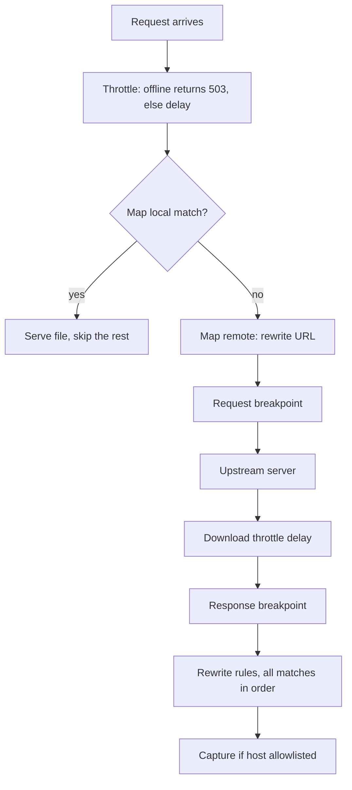
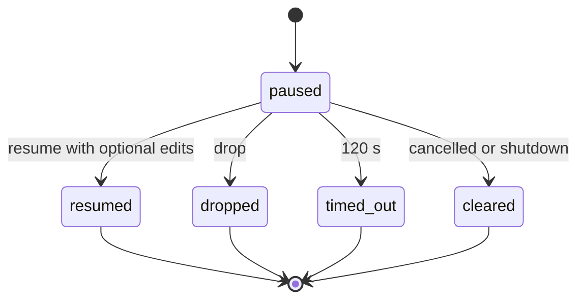

# Rules and breakpoints

Rules change proxied traffic. They apply only to the proxy path, never to SDK capture. Every mutating rule is disabled when created, and the dashboard shows a banner while any mutating rule is enabled.

## Storage and matching

`RuleEngine` ([services/rule_engine.py](../src/viewlift_ai/services/rule_engine.py)) holds a `RulesConfig` under a lock and saves it to `rules.json` through `RuleConfigStore`. Every change is saved, then listeners are notified (this is how allowlist edits reach the proxy live). New rules get `order = max + 1`.

Each rule has a `RuleMatch` with `fnmatch` globs:

- `method`: compared upper-case;
- `host`: lower-case, trailing dot removed;
- `path`: without the query string.

Empty or `*` matches anything.

## Rule types

| Kind | Purpose | Notes |
|---|---|---|
| `map-local` | Serve a file from disk | Path is relative to the map-local root. Absolute paths, `..`, drive letters and symlink escapes are rejected (`PathJailError`). Missing file returns `404`. Max 1 MiB. MIME type is guessed. |
| `map-remote` | Send the request to another URL | Target must be `http` or `https`, with a host and no credentials. Options `preserve_path` and `preserve_query`. |
| `rewrite` | Change the response | Actions: `set_header`, `remove_header`, `set_status` (100 to 599), `replace_body_literal`, `replace_body_regex`. Replacement up to 256 K characters, result up to 1 MiB. |
| `throttle` | Slow down or cut traffic | Latency (max 30,000 ms), upload and download kbps (1 to 100,000), or `offline`. |
| `breakpoints` | Pause request or response for editing | `request_enabled`, `response_enabled`. |

## Order of evaluation

Throttle combines every enabled matching rule: any `offline` wins (synthetic `503 Offline (throttle rule)`), latency takes the maximum, and bandwidth takes the minimum. Map local and map remote use the first match. Rewrites apply every match in order, each on top of the last; a failing rule is skipped and its error logged.

Implementation: [proxy/rules.py](../src/viewlift_ai/proxy/rules.py) (`apply_request_rules`, `apply_response_rules`).

## Breakpoints

[proxy/breakpoints.py](../src/viewlift_ai/proxy/breakpoints.py) implements `BreakpointRegistry`.

- A pause waits on an asyncio future in the mitmproxy loop, so other traffic keeps flowing.
- Resume edits are validated: up to 100 headers, name up to 256 characters, value up to 8192, no CR or LF, body up to 1 MiB, and `status` only at the response stage.
- Drop kills the flow.
- Timeout (120 seconds) lets the original traffic through unchanged and sets the flow error to `breakpoint timed out`.
- Shutdown resumes every paused flow unchanged.
- Events go to `/ws/flows` as `{"type": "breakpoint"}` messages. The Network page shows an editor for pending items.

## Network profiles

The Debug Suite and the `set_network_profile` MCP tool apply presets (`wifi`, `4g`, `3g`, `edge`, `gprs`, `offline`, or `off` to remove). A profile is stored as a throttle rule with id `debug-network-profile` and host `*`, so it affects every proxied app. Packet loss values are shown for reference only. Source: `apply_network_profile` in [services/debug_toolkit.py](../src/viewlift_ai/services/debug_toolkit.py).

## Key files

- [src/viewlift_ai/models/rules.py](../src/viewlift_ai/models/rules.py)
- [src/viewlift_ai/services/rule_engine.py](../src/viewlift_ai/services/rule_engine.py)
- [src/viewlift_ai/proxy/rules.py](../src/viewlift_ai/proxy/rules.py)
- [src/viewlift_ai/proxy/breakpoints.py](../src/viewlift_ai/proxy/breakpoints.py)
- [tests/test_rules_addon_order.py](../tests/test_rules_addon_order.py)

Next: [Multi-app and scope](multi-app-and-scope.md)
